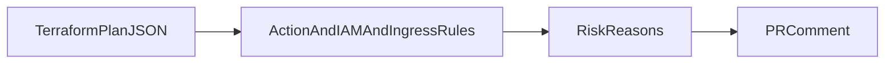

1. Parse a Terraform plan and score blast radius (deletes, IAM changes, data stores) with a PR comment.

2. Result:
   Seeded risky changes caught: 5  
   Safe controls evaluated: 5  
   False-positive rate: 0.0  

   Measured with `make bench`: [raw results](evidence/bench.json), [command output](evidence/checks.log), [environment](evidence/environment.json).

3. Architecture:


4. Run it:
```sh
make setup
make lint test bench
.venv/bin/python src/main.py --gate  # expected exit 1
```

5. Decisions and limits: Synthetic Terraform plan JSON only; no cloud resources are accessed or changed. Rules flag destruction/replacement, IAM changes, public ingress and unknown IAM values. False-positive rate describes the fixed safe controls, not general infrastructure. evidence/findings.json explains every flag. The GitHub Action comments a seeded report on same-repository PRs; production ingestion and broader provider schemas remain Next. evidence/gate-failure.log records a destructive plan being blocked. The report comment was verified at https://github.com/rjrddy/d4-infrastructure-change-risk-checker/pull/1#issuecomment-6291580294.

6. Next: Consume uploaded real plan artifacts with secret redaction and add provider-specific risk context.
